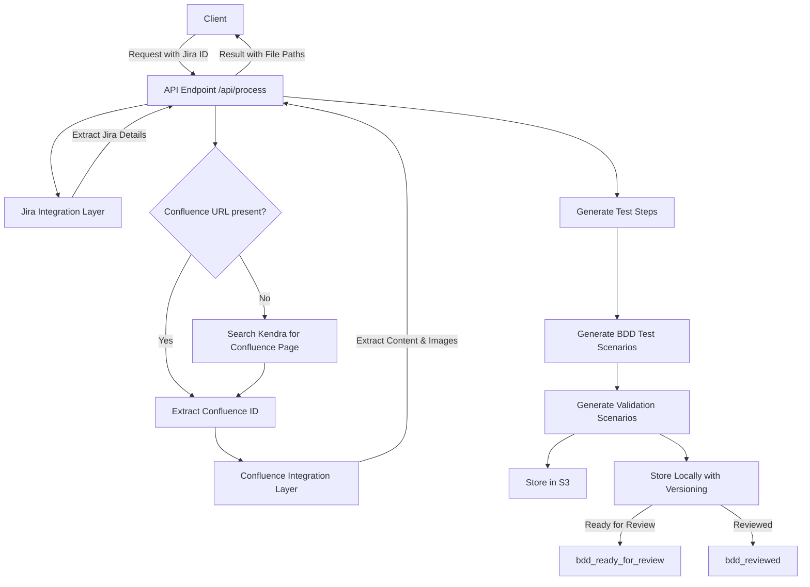
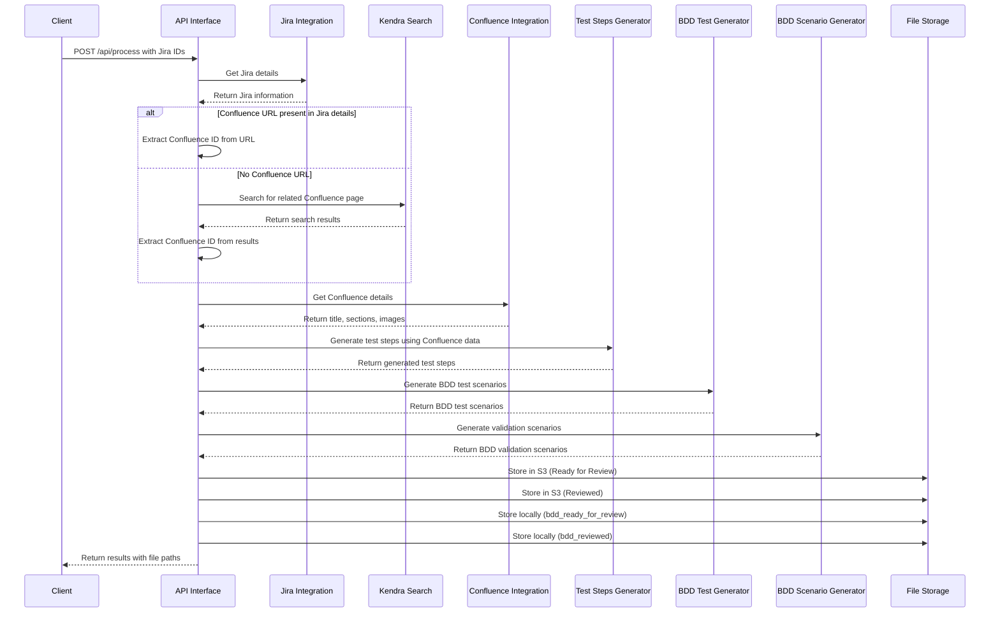
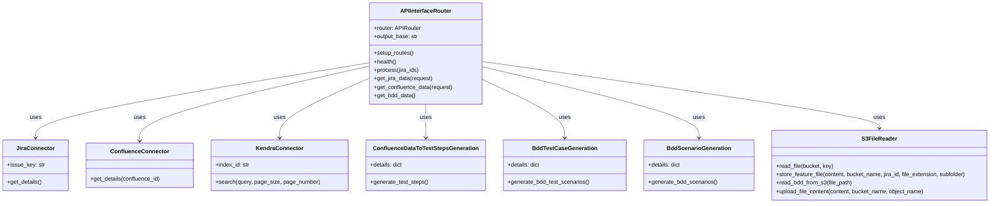
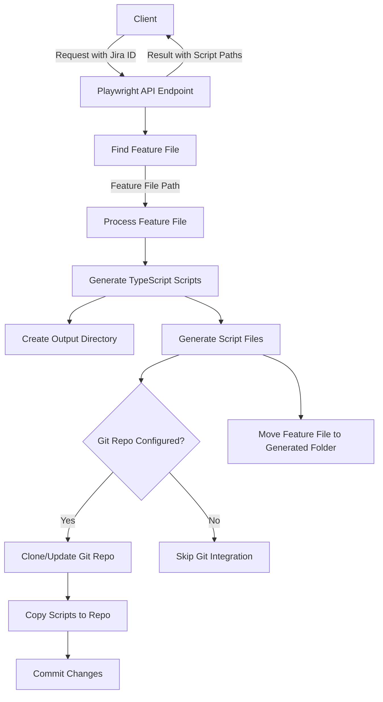
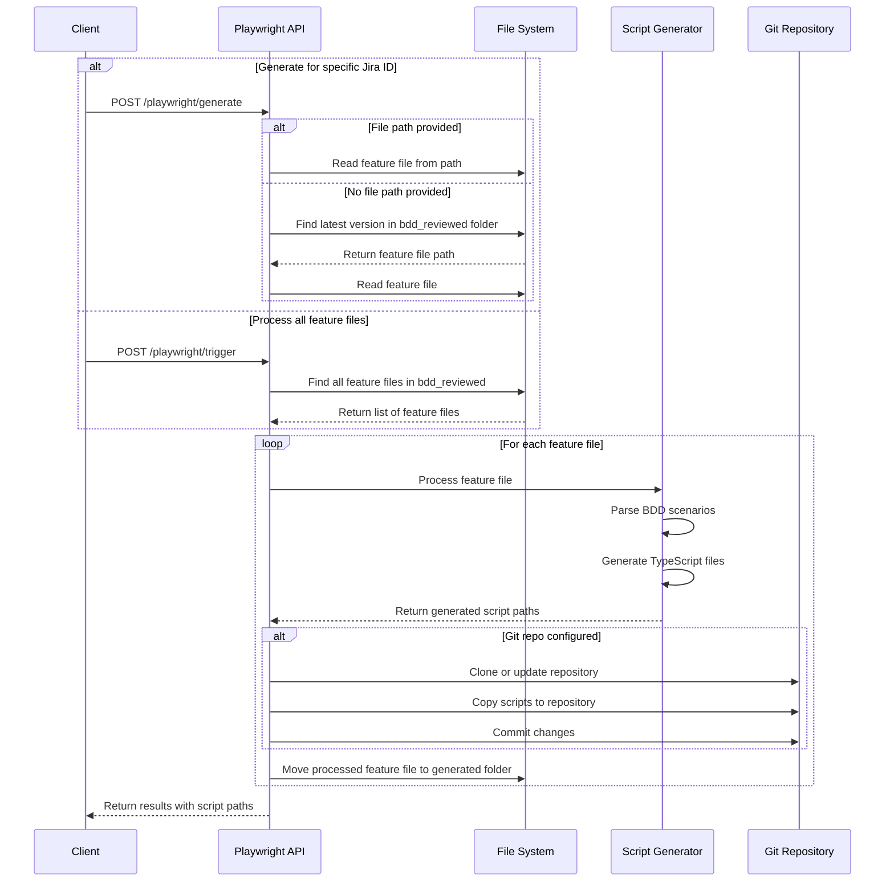
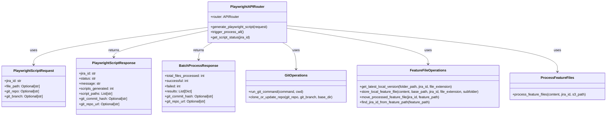
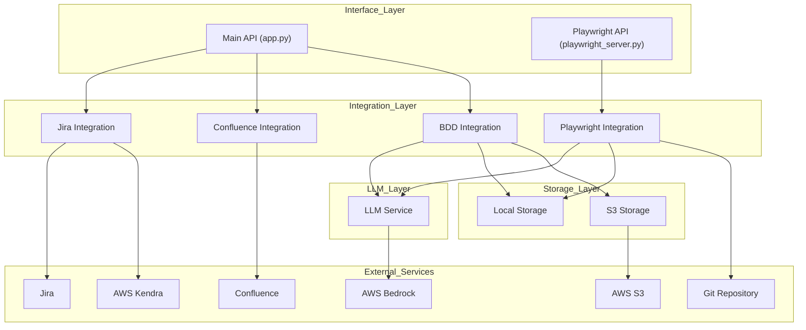

#GenAI Automation

This project contains two separate services:
1. Main GenAI Automation API - Generates BDD feature files
2. Playwright Script Generation API - Converts BDD feature files to TypeScript scripts

## Prerequisites

### Python Version Requirements

This project requires Python 3.9. Verify your Python version:

#### Windows
```bash
python --version
```

#### Mac
```bash
python3 --version
```

### Installing Python

If Python is not installed or you need to update:

#### Windows
1. Download Python 3.9 installer from [python.org](https://www.python.org/downloads/release/python-390/)
2. Run the installer, select "Add Python to PATH" during installation
3. Verify installation with `python --version`

#### Mac
```bash
# Using Homebrew
brew update
brew install python@3.9

# Verify installation
python3 --version
```

### Setting up Virtual Environment

#### Windows
```bash
# Create virtual environment
python -m venv .venv

# Activate virtual environment
/venv\Scripts\activate
```

#### Mac
```bash
# Create virtual environment
python3 -m venv .venv

# Activate virtual environment
source .venv/bin/activate
```

## Environment Setup

Create `src/.env` (or copy from `src/.env.example`) with:

```
# Main API Configuration
PORT=8000

# Playwright API Configuration 
PLAYWRIGHT_PORT=8001

# Git Repository for Playwright Scripts
GIT_REPO_URL=https://github.com/your-org/your-playwright-repo.git
GIT_BRANCH=main

# AWS — Bedrock, Secrets Manager (e.g. sandbox keys locally)
AWS_REGION=us-east-1
AWS_ACCESS_KEY_ID=your-key
AWS_SECRET_ACCESS_KEY=your-secret
AWS_SESSION_TOKEN=optional-session-token

# S3 recordings (corp bucket; separate credentials from AWS_* used for Bedrock / Secrets Manager)
S3_RECORDINGS_BUCKET=genai-chewy-automation
S3_RECORDINGS_PREFIX=Recordings
S3_RECORDINGS_AWS_REGION=us-east-1
S3_RECORDINGS_AWS_ACCESS_KEY_ID=your-corp-recordings-access-key
S3_RECORDINGS_AWS_SECRET_ACCESS_KEY=your-corp-recordings-secret
S3_RECORDINGS_AWS_SESSION_TOKEN=optional-session-token
```

`AWS_*` is used for Bedrock, Secrets Manager, and other services. `S3_RECORDINGS_AWS_*` is used only for recording uploads, presigned URLs, and the `/recordings/download` stream. In Kubernetes, map these to Secrets Manager properties listed under `externalSecrets` in `infra/helm/values.yaml`.

## Running the Services

### Main API Service

The main GenAI automation service handles the generation of BDD feature files:

```bash
# Install dependencies
pip install -r requirements.txt

# Run the main API
cd src
python app.py
```

The main API will run on port 8000 by default (or the PORT specified in your .env file).

### Playwright Script Generation API (TypeScript Generator)

This is a separate service that handles converting BDD feature files to Playwright TypeScript scripts:

```bash
# Run the Playwright API service
cd src
python playwright_server.py
```

The Playwright API will run on port 8001 by default (or the PLAYWRIGHT_PORT specified in your .env file).

## Accessing API Documentation and Key Endpoints

### Swagger UI

Both services provide Swagger UI documentation that can be accessed through:

- Main GenAI API: http://localhost:8000/docs
- Playwright Script API: http://localhost:8001/docs

### Key Endpoints to Use

For most use cases, you will primarily use these two endpoints:

1. From the Main API (api.py):
   - **POST** `/api/process` - Generates BDD feature files from Jira IDs

2. From the Playwright API (playwright_api.py):
   - **POST** `/playwright/trigger` - Process all feature files and generate TypeScript scripts

## Using the Playwright Script Generation API

The Playwright API provides the following endpoints:

### Process All Feature Files

This endpoint will scan the `../data/review/bdd_reviewed` directory for feature files, process them, and move them to a `generated` folder after processing. Generated TypeScript files will be stored in `../data/review/playwright_scripts/{jira_id}/`.

```
POST /playwright/trigger
```

Example request:
```bash
curl -X POST http://localhost:8001/playwright/trigger
```

This endpoint:
1. Reads all `.feature` files from the bdd_reviewed folder (excluding the 'generated' subfolder)
2. For each file, it:
   - Extracts the JIRA ID from the content or path
   - Generates TypeScript files for each scenario
   - Pushes the files to the Git repository (if configured in .env)
   - Moves the processed feature file to `/generated` folder with versioning

### Generate Scripts for Specific JIRA ID

Generate Playwright scripts for a specific JIRA ID:

```
POST /playwright/generate
```

Example request:
```bash
curl -X POST http://localhost:8001/playwright/generate \
  -H "Content-Type: application/json" \
  -d '{"jira_id": "CPX-123"}'
```

### Check Script Generation Status

Check the status of generated scripts for a specific JIRA ID:

```
GET /playwright/status/{jira_id}
```

Example request:
```bash
curl http://localhost:8001/playwright/status/CPX-123
```

## Directory Structure

- `/data/review/bdd_ready_for_review` - Feature files ready for review
- `/data/review/bdd_reviewed` - Reviewed feature files ready for processing
- `/data/review/bdd_reviewed/generated` - Processed feature files with versioning
- `/data/review/playwright_scripts` - Generated TypeScript files
- `/data/git_repos` - Local copy of Git repositories

## Versioning

The system implements versioning for feature files using the format:
`bdd_feature_{jira_id}_v{version}.feature`

When a file is processed, it's moved to the generated folder with an incremented version number.

## System Architecture Diagrams

### Use Case 1: BDD Feature File Generation (api.py)

#### Data Flow Diagram



#### Sequence Diagram



#### Low-Level Design



### Use Case 2: TypeScript Step Definition Generation (playwright_api.py)

#### Data Flow Diagram



#### Sequence Diagram



#### Low-Level Design



### System Architecture Overview



# Optimized Playwright Step Definition Generator

This project contains optimizations for the Chewy GenAI Automation system to significantly improve the performance of generating Playwright step definitions from BDD scenarios.

## Key Optimizations

1. **Browser Session Reuse**
   - Reuses the browser instance across multiple scenarios
   - Avoids the overhead of starting and stopping the browser for each scenario
   - Uses a function attribute to store the shared driver

2. **Context Caching**
   - Maintains a consistent context key for each JIRA ID
   - Avoids re-creating context for the same URL in different scenarios
   - Uses URL-to-context mapping for quick lookups

3. **Chromadb Connector Caching**
   - Added multi-level caching to the ChromaDB connector:
     - Context cache for fast retrieval of previously stored contexts
     - Query result cache to avoid redundant similarity searches
     - Hash-based content comparison to avoid unnecessary updates
   - Added performance metrics (cache hits/misses)

4. **Parallel Processing**
   - Added support for concurrent processing of multiple feature files
   - Configurable worker count to match system resources
   - Each file can be processed independently using ThreadPoolExecutor

## Performance Improvements

The optimizations provide significant performance benefits:

- **Reduced Processing Time**: The processing time per scenario is greatly reduced by avoiding redundant operations
- **Reduced CPU Usage**: Less CPU time spent on browser startup/shutdown and context indexing
- **Reduced Memory Usage**: Less memory used due to shared browser instance and cached contexts
- **Improved Scalability**: Parallel processing allows efficient use of multi-core systems

## Usage

To use the optimized step definition generator:

```bash
python src/optimize_step_generator.py [--parallel] [--workers N] [--dir PATH]
```

Options:
- `--parallel`: Process files in parallel (default: False)
- `--workers N`: Number of worker threads for parallel processing (default: CPU count)
- `--dir PATH`: Path to directory containing feature file (default: ../data/review/bdd_reviewed)

## Implementation Details

The optimizations are implemented in several key files:

1. `src/services/integration_layer/playwright_script_generation/processing_layer/main.py`
   - Modified `crawl()` function to support browser reuse and context caching

2. `src/services/integration_layer/playwright_script_generation/processing_layer/generate_bdd_script.py`
   - Modified `process_feature_files()` to reuse browser and context across scenarios
   - Added `process_feature_files_parallel()` for concurrent processing

3. `src/services/embedding_layer/chromadb_connector.py`
   - Added caching mechanisms to ChromaDBConnector for faster retrieval and storage
   - Optimized context comparison using hashing for better performance

4. `src/optimize_step_generator.py`
   - New script to run the optimized process with various configuration options

## Future Improvements

Potential areas for further optimization:

1. Implement a persistent browser pool for even better concurrency
2. Add distributed processing support for extremely large workloads
3. Implement persistent cache for context data between runs
4. Add more granular performance metrics and monitoring

## Requirements

The optimized system has the same requirements as the original system, with no additional dependencies.
